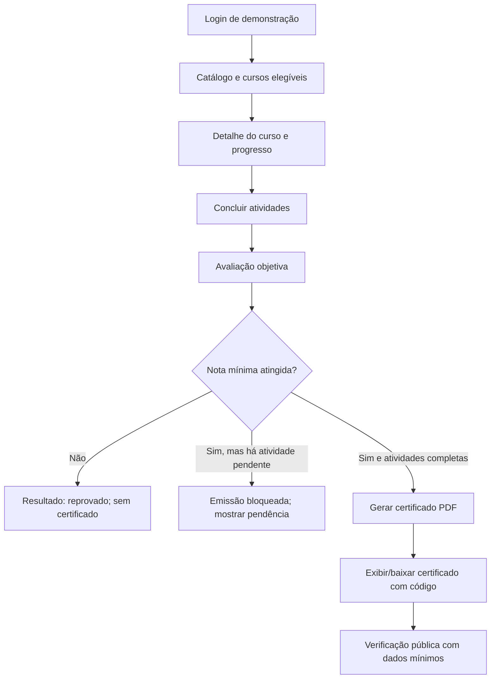

# Planejamento dos testes

## Portal de treinamentos e certificados | Modelo 2

**Projeto A3 de Garantia da Qualidade de Software — UNIFACS**  
**Versão 1.0 | 10 de novembro de 2026 | Entrega prevista: 11/11/2026**

## 1. Objetivo

Planejar como verificar o fluxo principal do portal proposto para Educação Corporativa e RH: um colaborador inicia um curso, conclui as atividades, realiza uma avaliação, recebe aprovação e obtém um certificado PDF verificável. O plano também cobre permissões, preservação do histórico, usabilidade por teclado e metas de desempenho indicadas no enunciado.

Este é um plano para a etapa de 11/11. O protótipo ainda não foi construído; portanto, os casos abaixo estão **planejados e não executados**. Nenhum resultado, evidência ou defeito é declarado nesta entrega. A aplicação usará integração simulada com RH e dados inteiramente fictícios.

## 2. Escopo

### Incluído

- Consulta ao catálogo e elegibilidade do curso por setor ou função.
- Registro do progresso e conclusão de atividades obrigatórias.
- Avaliação objetiva e aplicação da nota mínima geral de 70% ou de um limite superior configurado para o curso.
- Bloqueio do certificado quando houver atividade pendente ou reprovação.
- Geração do certificado PDF e verificação por código exclusivo.
- Atualização e arquivamento de curso, com preservação do histórico.
- Acesso de gestor restrito ao setor autorizado.
- Navegação principal por teclado e em viewport móvel.
- Planejamento das metas de desempenho: páginas principais em até três segundos com referência de 500 acessos simultâneos; certificado em até cinco segundos; disponibilidade mensal de 99,5%, excluída manutenção programada.

### Fora desta etapa

- Construção do protótipo, integração real com RH, autenticação institucional ou sistemas do hospital.
- Testes com dados pessoais reais, dados clínicos ou certificados oficiais.
- Validação jurídica de assinatura institucional, política de retenção ou conformidade operacional em produção.
- Execução dos testes de desempenho e medição de disponibilidade; dependem de protótipo, ambiente, carga e período de observação definidos.

## 3. Estratégia e técnicas

1. **Caixa-preta funcional:** comparar entradas, ações e saídas com requisitos e critérios de aceitação, sem depender da implementação interna.
2. **Particionamento de equivalência:** separar cenários de colaborador elegível/não elegível, curso aberto/suspenso/arquivado, aprovado/reprovado e código válido/inválido.
3. **Análise de valores-limite:** verificar notas em 69%, 70% e acima de 70%; para curso com limite superior configurado, testar o valor imediatamente abaixo, o limite e acima dele.
4. **Tabela de decisão:** combinar conclusão das atividades e nota para verificar se o certificado pode ou não ser emitido.
5. **Teste de permissões:** conferir acesso permitido e negado para colaborador, gestor e administrador, com contas e setores fictícios.
6. **Inspeção de interface:** percorrer o fluxo por teclado e em viewport móvel; observar rótulos, foco, mensagens de erro e indicação de progresso.
7. **Caixa-branca:** aplicar revisão de código e testes unitários somente quando o código do protótipo existir. Não se declara cobertura ou análise estática nesta entrega.
8. **Não funcional:** preparar medição controlada para tempos de resposta e emissão. O teste de disponibilidade exige observação por um mês e será tratado como acompanhamento, não como teste pontual.

## 4. Ambiente, dados e recursos

| Item | Preparação planejada |
|---|---|
| Aplicação | Protótipo local ou ambiente acadêmico isolado, sem integração externa real |
| Navegadores | Navegador desktop atual e viewport móvel; versões exatas a registrar antes da execução |
| Dados | Cursos, setores, matrículas, contas, notas e códigos inteiramente fictícios |
| Perfis | Colaborador do Setor A, colaborador do Setor B, gestor do Setor A e administrador |
| Curso padrão | Nota mínima de 70%; atividades obrigatórias definidas para o cenário |
| Curso com limite superior | Curso fictício configurado com nota mínima de 80% |
| Evidências | Captura de tela sem identificadores reais, resultado observado, data, versão do protótipo e registro de defeitos |
| Recursos | Protótipo executável, massa de dados controlada, roteiro dos casos e ferramenta de captura/registro a definir pela equipe |

Antes de cada execução, restaurar a massa de dados conhecida e conferir a versão do protótipo. Não inserir dados pessoais ou clínicos reais nas telas, capturas, logs ou certificados de demonstração.

## 5. Níveis de teste

| Nível | Aplicação ao projeto | Situação nesta entrega |
|---|---|---|
| Unidade | Regras de nota, elegibilidade, conclusão e geração/validação de código, isoladas em componentes | Planejado para quando houver código; não executado |
| Integração | Comunicação entre catálogo, progresso, avaliação, certificados, histórico e cadastro de RH simulado | Planejado; sem integração real |
| Sistema | Jornada ponta a ponta, permissões, arquivamento, interface e requisitos de desempenho selecionados | Casos especificados; execução futura no protótipo |
| Aceitação | Conferência da jornada e das regras com representantes acadêmicos/usuários simulados | Depende de validar ambiguidades e disponibilizar o protótipo |

## 6. Critérios de entrada e saída

### Entrada para a execução

- Protótipo identificado por versão e disponível em ambiente de teste.
- Requisitos e decisões ainda abertas revisados; ambiguidades não resolvidas registradas como premissas ou casos bloqueados.
- Contas e dados fictícios preparados para cada perfil e cenário.
- Fluxo principal navegável, sem falha que impeça iniciar um caso.
- Ambiente, navegador e condições de desempenho documentados para os casos não funcionais.

### Saída proposta

- Todos os casos de prioridade P1 executados, com resultado e evidência registrados; qualquer caso bloqueado tem motivo e responsável anotados.
- Critérios de aprovação, reprovação e emissão de certificado demonstrados sem falhas abertas de severidade crítica ou alta.
- Defeitos restantes classificados, vinculados ao requisito e com decisão registrada (corrigir, aceitar para demonstração ou adiar).
- Resultados de desempenho só são avaliados contra limites quando ambiente e perfil de carga acordados forem reproduzíveis.
- A equipe revisa os resultados e registra a decisão de aceite da versão. Os limiares de saída são proposta da equipe para validação, não regra expressa do enunciado.

## 7. Priorização e riscos

Escala proposta: probabilidade (P) e impacto (I) de 1 a 3. Pontuação = P × I. Alto: 6–9; médio: 3–4; baixo: 1–2. A classificação deve ser revista após respostas dos interessados e resultados do protótipo.

| ID | Risco | P | I | Nível | Resposta/teste associado |
|---|---|---:|---:|---|---|
| R-01 | Certificado emitido sem conclusão ou aprovação válida | 2 | 3 | Alto | Testar a tabela de decisão de conclusão × nota; CA-01, TC-04 a TC-06 |
| R-02 | Consulta pública de código revelar matrícula ou outros dados desnecessários | 2 | 3 | Alto | Conferir conteúdo da resposta pública; TC-08 e TC-09 |
| R-03 | Colaborador ou gestor acessar curso ou dados de setor fora de seu perfil | 2 | 3 | Alto | Testes de autorização negativa; TC-02, TC-12 |
| R-04 | Alteração ou arquivamento de curso apagar ou corromper histórico existente | 2 | 2 | Médio | Comparar histórico antes/depois; TC-10 e TC-11 |
| R-05 | Tentativas, validade do certificado ou avisos de vencimento serem implementados com regra errada por ambiguidade | 3 | 2 | Alto | Bloquear/condicionar casos dependentes até decisão; perguntas da Entrega 1 |
| R-06 | Páginas ou emissão excederem o tempo de resposta sob a carga de referência | 2 | 2 | Médio | Medição de desempenho planejada; TC-15 e TC-16 |
| R-07 | Falhas de teclado ou viewport móvel impedirem concluir treinamento | 2 | 2 | Médio | Inspeção do fluxo e execução sem mouse; TC-13 e TC-14 |

## 8. Casos de teste planejados

**Convenções:** P1 = essencial para demonstrar o fluxo e as regras centrais; P2 = importante para segurança operacional e qualidade; P3 = depende de decisão ou recurso de ambiente. “Resultado esperado” define o que será observado, ainda sem resultado real.

| ID / prioridade | Requisito | Pré-condições e dados | Passos resumidos | Resultado esperado |
|---|---|---|---|---|
| TC-01 / P1 | RF-01, RF-02 | Colaborador fictício elegível e curso aberto | Acessar com matrícula/senha de demonstração; abrir catálogo | Acesso concedido e catálogo mostra cursos pertinentes, obrigatórios e opcionais |
| TC-02 / P1 | RF-02, RF-11 | Colaborador do Setor B; curso destinado ao Setor A | Abrir catálogo e tentar acessar o curso do Setor A | Curso não aparece como disponível ou acesso é negado; nenhuma informação restrita é exibida |
| TC-03 / P1 | RF-03, RF-04 | Curso padrão com atividades completas; nota de 70% | Completar curso e responder avaliação com pontuação exatamente no limite | Sistema registra aprovação e data; habilita certificado |
| TC-04 / P1 | RF-06, RF-07 | Curso padrão; nota de 69% | Completar atividades e submeter avaliação abaixo de 70% | Sistema registra reprovação, explica o resultado e não habilita certificado |
| TC-05 / P1 | RF-05, RF-06, RF-07 | Curso configurado com nota mínima de 80% | Submeter avaliações com 79% e 80% em execuções separadas | 79% reprova e 80% aprova; regra configurada prevalece sobre o padrão de 70% |
| TC-06 / P1 | RF-07, RF-08 | Curso padrão; nota aprovada, uma atividade obrigatória pendente | Tentar concluir/emitir certificado | Emissão bloqueada; sistema indica atividade pendente e preserva o progresso |
| TC-07 / P1 | RF-08, RNF-04 | Colaborador fictício aprovado e curso com carga horária conhecida | Acionar emissão e medir do aceite da solicitação até o PDF disponível | PDF disponível em até cinco segundos e contém os campos definidos; código é exclusivo |
| TC-08 / P1 | RF-09 | Certificado de teste emitido e código válido | Abrir verificação e informar código válido sem autenticação, conforme proposta a validar | Autenticidade confirmada e resposta revela somente os dados aprovados pelos interessados |
| TC-09 / P1 | RF-09 | Código fictício inexistente | Consultar código inexistente | Sistema informa que não localizou ou não validou o certificado, sem revelar dados de outra pessoa |
| TC-10 / P1 | RF-05, RF-10 | Curso com histórico e certificado já registrados | Arquivar curso; consultar histórico com perfil autorizado | Curso é arquivado sem apagar registros anteriores; novas inscrições obedecem ao estado definido |
| TC-11 / P2 | RF-05, RF-10 | Curso com histórico; administrador autorizado | Atualizar conteúdo/nota mínima e consultar registros anteriores | Atualização é aplicada conforme regra; histórico e certificado emitido não são alterados indevidamente |
| TC-12 / P1 | RF-11, RN-05 | Gestor do Setor A e colaborador do Setor B | Consultar relatório do Setor A e tentar obter relatório do Setor B | Gestor vê apenas o setor autorizado; tentativa não autorizada é negada e não retorna dados |
| TC-13 / P2 | RNF-02 | Fluxo principal disponível; sem mouse | Usar Tab, Shift+Tab, Enter e teclas aplicáveis do início ao certificado | Foco visível e ordem compreensível; controles e mensagens principais são alcançáveis; bloqueios são registrados |
| TC-14 / P2 | RNF-01 | Navegador e viewport móvel escolhidos | Percorrer catálogo, curso, avaliação e resultado em tela móvel | Conteúdo e controles permanecem utilizáveis sem rolagem horizontal indevida; problemas são registrados |
| TC-15 / P2 | RNF-03 | Ambiente e carga de 500 acessos simultâneos definidos e reproduzíveis | Medir tempo de resposta das páginas principais sob o perfil acordado | Tempos são registrados por operação e comparados ao limite de três segundos; teste não executável sem ambiente/carga acordados |
| TC-16 / P2 | RNF-04 | Emissão repetível com dados fictícios e ambiente de carga definido | Repetir a geração sob condições acordadas e registrar duração | Cada emissão atende ao limite de cinco segundos ou gera defeito com evidência e condições de reprodução |
| TC-17 / P3 | RNF-05 | Monitoramento e janela mensal acordados | Acompanhar disponibilidade durante um mês, excluindo manutenção programada aprovada | Indicador calculado com regra documentada e comparado à meta de 99,5%; não é concluído em teste pontual |
| TC-18 / P3 | RF-12 | Política de vencimento, antecedência e canal decididos | Criar treinamento com vencimento próximo e observar notificação | Aviso é enviado ao destinatário e no prazo acordados; caso bloqueado enquanto regra não for definida |

## 9. Rastreabilidade requisito–critério–teste

| Requisito | Critério de aceitação relacionado | Casos planejados |
|---|---|---|
| RF-01, RF-02 | CA-07 | TC-01, TC-02 |
| RF-03, RF-04, RF-06, RF-07 | CA-01, CA-02 | TC-03 a TC-06 |
| RF-05, RF-10 | CA-05 | TC-10, TC-11 |
| RF-08, RNF-04 | CA-03 | TC-07, TC-16 |
| RF-09 | CA-04 | TC-08, TC-09 |
| RF-11, RN-05 | CA-06 | TC-12 |
| RF-12 | Pergunta de validação sobre validade/avisos | TC-18 (bloqueado até decisão) |
| RNF-01, RNF-02 | CA-07 | TC-13, TC-14 |
| RNF-03 | CA-08 | TC-15 |
| RNF-05 | CA-08 | TC-17 |

## 10. Fluxo do protótipo e esboço de telas

| Tela | Elementos principais a esboçar | Verificações previstas |
|---|---|---|
| T1 — Acesso | Matrícula fictícia, senha, ação entrar, mensagem de erro | Teclado, validação, não revelar credenciais |
| T2 — Catálogo | Busca/filtros simples, curso, carga horária, período, público-alvo e estado obrigatório | Elegibilidade, curso indisponível, leitura em viewport móvel |
| T3 — Curso e progresso | Conteúdo simulado, lista de atividades, estado concluído/pendente, progresso | Persistência, indicação de pendência, acesso por perfil |
| T4 — Avaliação e resultado | Questões objetivas, envio, nota mínima, resultado e explicação | Limites 70%/80%, reprovação e aprovação |
| T5 — Certificado | Identificação aprovada, curso, carga horária, conclusão, código e baixar PDF | Campos, tempo de emissão, código exclusivo |
| T6 — Verificação | Campo para código, ação consultar e estado válido/não localizado | Exposição mínima de dados e código inválido |
| T7 — Gestão | Cursos e configuração; estado e arquivamento | Atualização sem perda de histórico |
| T8 — Relatório do gestor | Setor autorizado, inscrições, aprovações, reprovações, conclusões e pendências | Isolamento entre setores e legibilidade |

## 11. Registro de resultados e defeitos para a próxima etapa

Na execução futura, cada caso deve receber status **passou**, **falhou**, **bloqueado** ou **não executado**, com data, versão, ambiente, evidência e responsável. Cada defeito deve conter identificador, caso relacionado, passos para reproduzir, resultado esperado, resultado observado, severidade, prioridade, evidência e situação da correção. Testes apenas planejados devem continuar identificados como não executados.

## 12. Pendências para aprovação

- Confirmar limite e política de novas tentativas da avaliação (ilimitadas ou até três, conforme divergência descrita no enunciado).
- Definir assinatura, campos do certificado e conteúdo visível na verificação pública.
- Definir validade dos cursos, antecedência/canal dos avisos e comportamento de reemissão/cancelamento.
- Definir navegadores suportados, critérios de acessibilidade, massa de carga e condições de medição de desempenho/ disponibilidade.
- Confirmar perfis e ações administrativas, retenção de dados e responsáveis pela homologação.

As pendências mantêm coerência com a análise de requisitos da [Entrega 1](entrega-01-analise-requisitos.md). A próxima etapa do cronograma, prevista para 18/11, trata da primeira versão funcional do protótipo e inspeção.

